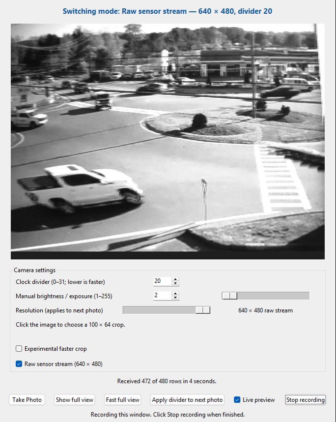
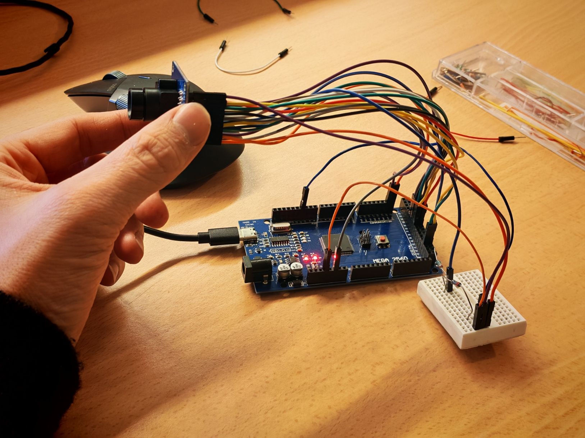

# Squeezing the Mega — OV7670 Camera

A personal learning project from my first year studying Robotics and Automation. I wanted to see what I could get working with an OV7670 camera **without FIFO**, an Arduino Mega 2560, and its 8 KB of SRAM.

It grew into a small camera system with a Windows/Python viewer, several capture modes, and experiments with direct port reads and cycle-timed pixel sampling.

[Watch the demo video](assets/demo.mp4)

## Features

- Live grayscale preview, click-to-select crop and manual exposure.
- 160 × 120 scaled full view, 100 × 64 sensor crop and 640 × 480 raw Bayer stream.
- AVR assembly crop reader synchronized to PCLK; no external frame buffer.
- Photo saving and a window recorder that demonstrates the modes.

## Camera image examples

| Raw Bayer stream | Small grayscale view |
| --- | --- |
|  |  |
| A 640 × 480 raw Bayer frame streamed byte by byte and displayed as grayscale; the visible sensor mosaic has not been demosaiced. | A saved 160 × 120 grayscale photo, matching the fast full-view dimensions. Its original camera settings were not recorded. |

Both examples are displayed 90° counterclockwise; their original pixel data is preserved.

## Measured performance

Measurements on the tested Mega/CH340 setup at **1 Mbps**, after warm-up. Times include sensor capture and serial transfer; results are short-run observations, not guaranteed frame rates.

| Mode | Camera divider | Measured frame time | Notes |
| --- | ---: | ---: | --- |
| 160 × 120 full view | 2 | 0.604 s median | 5 frames |
| 100 × 64 normal crop | 3 | 0.806 s median | 5 frames |
| 100 × 64 timed crop | 2 | 0.604 s median | 10 separate pattern frames checked |
| 100 × 64 timed crop | 1 | 0.39–0.41 s | Experimental; occasional row shifts |
| 640 × 480 raw Bayer | 22 | 4.631 s median | 3 frames; default raw setting |
| 640 × 480 raw Bayer | 20 | 4.20–4.31 s | 6 matching pattern frames; less margin |

The faster divider-1 crop is used by the recording demo and tested by script; the normal GUI experimental crop uses divider 2. [Recorded measurements](results/) include test conditions and pattern results.

## Wiring

| OV7670 | Mega 2560 |
| --- | --- |
| GND / 3.3V | GND / 3.3V |
| SDA / SCL | 20 / 21 |
| VS / HS / PCLK | 48 / 47 / 49 |
| MCLK | 11 through a 1 kΩ / 1 kΩ divider to GND |
| D0–D7 | 37, 36, 35, 34, 33, 32, 31, 30 |
| PWDN / RST | GND / 3.3V |

This is the **tested wiring, not an electrically verified design**. The sensor runs from an 8 MHz input clock, below the bare OV7670's specified 10 MHz minimum. The module's voltage tolerance is unknown, and Mega SDA/SCL pull-ups can be 5 V. Verify your module and use suitable level shifting.

## Setup

1. Open `OV7670_Direct/OV7670_Direct.ino` in Arduino IDE, select **Mega 2560**, and upload.
2. Install Python 3 with Tkinter, then run `py -m pip install -r OV7670_Direct/requirements.txt`.
3. Set `PORT` in `OV7670_Direct/camera_direct.py` to your serial port; the default is `COM8`.
4. Close the serial monitor and run `OV7670_Direct/Open Camera.bat` or `py OV7670_Direct/camera_direct.py --fast`.

Click **Fast full view**, then click an area to crop. **Record demo** starts a five-second countdown and records the window to `OV7670_Camera/recordings`; use **Stop recording** to save the silent MP4. Close the app before running hardware tests. For example: `py OV7670_Direct/test_raw_mode.py --divider 20 --frames 6`.

## Limitations

The crop buffer uses 6,400 bytes, leaving about 1.1 KB of SRAM for stack and locals. Raw Bayer is displayed as grayscale, not demosaiced color. Pattern tests do not prove absolute alignment or long-term stability. Divider 1 can shift crop rows; full raw capture at divider 19 failed on a repeat test. On this particular CH340 connection, 2 Mbps tests lost bytes, so the app uses 1 Mbps.

## Acknowledgments

FIFO-less OV7670 streaming on 8-bit AVR hardware predates this project; see [ComputerNerd's Arduino Uno implementation](https://github.com/ComputerNerd/ov7670-no-ram-arduino-uno). Sensor configuration is also documented in the [OV7670 datasheet](https://www.olimex.com/Products/Components/Camera/CAMERA-OV7670/resources/OV7670.pdf) and the [Linux OV7670 driver](https://github.com/torvalds/linux/blob/master/drivers/media/i2c/ov7670.c). These are references and related work, not claims of direct code derivation.

I came up with the project ideas, guided the features and changes, wired up the hardware, and tested and debugged the results. AI tools helped extensively with writing and refining the firmware, Python application, and documentation. This is an ongoing experiment and learning project.

Third-party code provenance and reuse permissions have not been definitively cleared; no license is selected at this stage.
